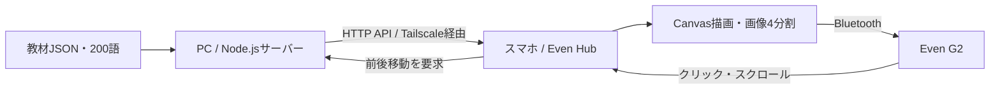

# Even G2 — スマートグラス向け学習・情報表示アプリ

Even G2に英単語や日本語ニュースを表示する個人開発プロジェクトです。
代表作は **Vocabulary Large**。英単語・和訳・例文を大きな文字で表示し、PCから配信する教材を自動で切り替えます。

## 解決したい課題

低輝度でも文字を読みやすくしたいという課題に対し、ネイティブの文字コンテナでは変更できない文字サイズを、Canvasで文字を画像化することで調整しました。
画像はデバイスの制約に合わせて4枚に分割し、スマートフォンからグラスへ転送します。

## 代表作：Vocabulary Large



- PCが10秒ごとにカードを切り替え、表示位置を保存。再起動時に復元します。
- スマホが次回更新時刻に合わせて取得し、同じ更新番号なら画像転送を省略します。
- クリック・スクロールによる前後移動、通信復旧・復帰時の再同期に対応します。
- 教材データを配信側に置き、教材変更時のアプリ再パッケージを不要にしました。

TypeScript、Canvas、Even Hub SDK、Node.jsのHTTPサーバーを使用しています。
常用環境ではTailscaleで通信経路を限定し、systemdユーザーサービスでサーバーを常駐させる構成です。

### コードの入口

| ファイル | 内容 |
|---|---|
| [src/main.ts](vocabulary-large/src/main.ts) | API取得、グラスへの転送、入力イベント、再同期 |
| [src/renderCard.ts](vocabulary-large/src/renderCard.ts) | 文字描画と画像分割 |
| [server/index.mjs](vocabulary-large/server/index.mjs) | カード切替、HTTP API、状態保存 |
| [scripts/test-network.mjs](vocabulary-large/scripts/test-network.mjs) | クライアントの取得・通信復旧のテスト |
| [server/server.test.mjs](vocabulary-large/server/server.test.mjs) | 自動更新、競合、状態復元のテスト |

### 試す

Node.js **22.23.2以上の22系**を想定しています。各アプリは独立したnpmプロジェクトです。

```sh
cd vocabulary-large
npm ci
npm test
npm run build
npm run vocabulary-server
```

別のターミナルで同じディレクトリから `npm run sim` を実行します。
開発時はViteの `/vocabulary-api` プロキシからPCのAPIへ接続するため、単語帳のシミュレーター確認にTailscaleの設定は不要です。
グラスの表示・操作を体験するにはEven Hubシミュレーターまたは実機の環境が必要です。
通常のブラウザだけではグラスとのブリッジ接続が完了しません。

実機・Beta版の接続先設定は [単語帳README](vocabulary-large/README.md) を参照してください。
このリポジトリのURL、パッケージID、常駐設定のパスは公開用の例です。

### 検証範囲と現在の課題

既存の自動テストでは、旧オフライン版のライフサイクル、PC配信版の取得・更新省略・復帰・終了、サーバーの自動更新・前後移動・状態復元などを検証します。
SDK・画像描画の一部はテスト用の代替実装を使用しています。
実機のBluetooth通信やiPhoneスリープ中の長時間安定動作は、これらのテストで保証されません。
PC配信化だけでスリープ中のクラッシュを解消したとは断定していません。

## 関連する試作

| プロジェクト | 内容 |
|---|---|
| [vocabulary-large](vocabulary-large/README.md) | 大きな画像文字による英単語学習。代表作 |
| [japanese-large](japanese-large/README.md) | 日本語をCanvasで大きく表示する最小試作 |
| [english-flow](english-flow/README.md) | ネイティブ文字表示による英語学習カード配信 |
| [news-flow](news-flow/README.md) | ネイティブ文字表示によるRSSニュース配信 |
| [news-large](news-large/README.md) | 画像文字によるニュース表示・ページ分割 |

ニュースアプリの設定例は外部APIキー不要の `mock` モードです。
実ニュースの取得には `rss` モードを明示してください。

## 開発について

開発・公開用整理にはCodexによるAI支援を利用しています。
このリポジトリは公開用に切り出したソースであり、元の開発履歴や個人環境の設定は含めていません。
公開手順と確認結果は [PUBLISHING.md](PUBLISHING.md) を参照してください。
